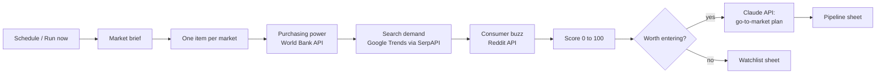

# Market Radar

**An n8n + Claude AI agent that finds which markets are ready for a product, and writes the go-to-market plan for each one worth entering.**

Built by [Meghna Ahuja](https://www.linkedin.com/in/meghnaahuja) · [Portfolio](https://meghna-ahuja.vercel.app/)

---

## What it does

Give it a product, a search keyword and a list of countries. Every Monday (or on demand) it:

1. **Collects signals** for each market from free public APIs
2. **Scores** each market from 0 to 100
3. **Decides** whether the market is worth entering
4. **Writes a go-to-market strategy** with Claude for the winners
5. **Logs everything** to Google Sheets: a `Pipeline` tab for go markets and a `Watchlist` tab for the rest

## How it works

| Signal | Source | Weight |
|---|---|---|
| Search demand (12-month interest and growth) | Google Trends via SerpAPI | 35% |
| Consumer buzz (posts and engagement) | Reddit search API | 25% |
| Purchasing power (GDP per capita, population) | World Bank API | 25% |
| Low competition | Derived | 15% |

The Claude step receives each market's score and raw signals and returns **structured JSON**: target segment, positioning, pricing, channels, partnerships, a launch plan from 0 to 1, scaling from 1 to 10 and 10 to 100, KPIs and risks.

## Example brief

The default brief tests a **premium K-beauty skincare line** across European markets, inspired by a launch project I worked on with L'Oréal at HEC Paris. Swap the product, keyword and markets in the `Market brief` node to run it for anything.

## Setup

1. Import `workflow/market_radar.json` into n8n (Workflows → Import from file).
2. **Market brief:** add your SerpAPI key in `serpapiKey` (free tier works). Without it, search demand is skipped.
3. **Claude strategy:** create a Header Auth credential named `x-api-key` with your Anthropic API key.
4. **Google Sheets:** pick your spreadsheet and create two tabs, `Pipeline` and `Watchlist`.
5. Adjust the score cut-off in the `Worth entering?` node.

No keys are stored in this repository.

## Tech

n8n · JavaScript (Code nodes) · Claude API (Anthropic) · SerpAPI · Reddit API · World Bank API · Google Sheets

## Why I built it

At L-Acoustics Group I build market-sizing models and automated research pipelines. Market Radar is the side-project version of that idea: turning scattered public data into a clear "where should we launch next, and how" answer in minutes instead of weeks.
